  

  <h1>AiriBot</h1>
  
<strong>A personal Discord bot project by Sairi(N)</strong>

  
Useful, configurable commands for the everyday life of a Discord server.

  

    
    &nbsp;
    
  

  
<a href="#about">About</a> &nbsp;·&nbsp; <a href="#features">Features</a> &nbsp;·&nbsp; <a href="#project-details">Project details</a> &nbsp;·&nbsp; <a href="#copyright">Copyright</a>

---

## About

AiriBot is a prefix-based Discord bot built with **Python** and **discord.py**. It’s a personal project created by Sairi(N), with a focus on practical server tools and a little fun along the way.

> This is an independent creator project—not a company, store, or official Discord product.

## What’s inside

| 🧰 Utilities | 🛡️ Moderation | 👤 Profiles |
|:--|:--|:--|
| Handy everyday commands | Tools for server management | Profile-related commands |

| 🏠 Server information | 🎉 Fun | 🕒 Time |
|:--|:--|:--|
| Details about your community | Light-hearted commands | Time-related tools |

  <a href="https://github.com/Airi-official/AiriBot"><strong>Visit the AiriBot repository →</strong></a>

## Project details

- **Creator:** Sairi(N)
- **Project:** [AiriBot](https://github.com/Airi-official/AiriBot)
- **Built with:** Python · discord.py
- **Documentation:** No official documentation is published yet.
- **Questions or support:** [Open an issue in the AiriBot repository](https://github.com/Airi-official/AiriBot/issues).

## Copyright & attribution

© Sairi(N). AiriBot and its original project materials are created and maintained by Sairi(N). Discord and other third-party names, logos, and materials remain the property of their respective owners. This project is not affiliated with or endorsed by Discord.

---

  Made with care by Sairi(N) · Personal creator profile for AiriBot

